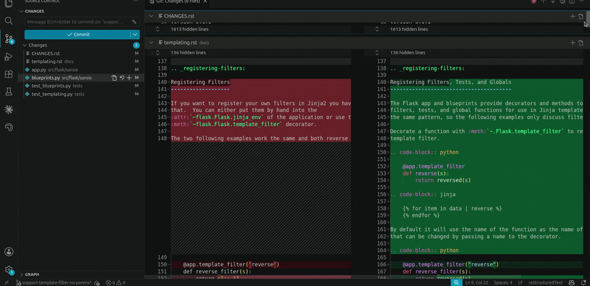

# Seam — review by intent

> **Stop scrolling diffs line-by-line. Review by intent, not by file.**

<p align="center">
  
  <br>
  <em>A real <a href="https://github.com/pallets/flask/pull/5736">Flask pull request (pallets/flask#5736)</a>, decomposed into seams — review the cores, skim the tests, skip the docs.</em>
</p>

Seam takes a real change and presents it **decomposed into seams** — units of *one intent*,
each hunk labelled by role (**core / link / environment / test / noise**) with its wiring — so you
review *by intent* instead of scrolling file-by-file. It works on a **diff** (what you changed) and
on a **codebase footprint** (where an intent lives across the repo).

It **structures, it does not judge.** No score, no approval, no "the LLM reviewed it for you." It
only pays the tax of reconstructing a change's structure so a triangulating review can happen
without the linear scroll fighting it. The human still trusts.

**Language-agnostic by construction.** The same structural engine works across
**TypeScript/JavaScript, Java, Ruby, C, and C++** — definitions, references, and class heritage come
from tree-sitter, so adding a language is a grammar, not a rewrite. Framework conventions a static
scan would miss are recovered *agnostically* — **DI wiring** (interface → implementation),
**container-invoked entry points** (`@GetMapping`/`@Path`/`onMessage`/`@Scheduled`, detected by
annotation **presence**, never a hardcoded per-framework list), and **pub/sub messaging** (emitter ↔
handler by shared event/topic) — from node kinds and heritage, with **zero per-framework code**. When
a relation genuinely needs a framework's API name to even *find*, it falls to the LLM discover tier as
a `SUGGESTED` lead, never asserted.

The engine is a **stateless TypeScript library** (`ts/`). Every surface — the CLI, the VS Code
extension, the MCP server, a future IntelliJ plugin — is a thin client over **one versioned JSON
contract** (`--emit-seams`). See [`ARCHITECTURE.md`](ARCHITECTURE.md) for the full model and the
reasoning.

## Two modes

| Mode | Anchor | Answers |
|---|---|---|
| **Diff** | a unified diff / `git diff <range>` | *What does this change do, and how do I review it by intent?* |
| **Codebase** | a symbol, a module file, or just a natural-language intent | *Where does this intent live — who consumes it, what does it wire?* |

**Diff mode** groups the hunks of a change into seams. **Codebase mode** starts from an anchor
(a symbol, or a whole module) and traces its **intent footprint** across the repo — consumers and
dependencies — then decomposes *that* into seams. Codebase mode is **honest about static gaps**:
edges it can't resolve come back as `SUGGESTED` / `blindspots` (a boundary to verify), never asserted
as real.

Codebase mode doesn't *guess* where an intent lives — it **grows the footprint deterministically**
(`--grow det`, the default): it follows the resolved crossings (imports, shared-keys, HTTP routes) to
the terminals with **zero LLM**, skipping moves that would flood the map with a generic util. The
model is asked only to *name and tier* what the trace already found — it **never invents an edge**
(`--grow llm` keeps the older LLM-directed move-picker).

You don't have to know the anchor. Given **just a natural-language intent** (`--auto` with no
`--symbol`), the engine **selects the starting symbol itself**: it probes the best name-matched
candidates with a cheap deterministic grow, **discards the ones whose footprint dead-ends** (so a
name-matching-but-isolated symbol can't be picked and hide the real answer), and an **LLM judges
which connected footprint is the intent's entry point** — then grows that one. This is the same
split as everywhere else: structure measures connectedness (a fact), the LLM judges relevance (the
meaning). LLM query-expansion widens recall so *"registration"* still finds `RegisterPage`.

**Agent-facing surface (opt-in).** For a coding agent that calls Seam instead of running a grep loop,
three additions read the same emitted model: **`--format agent`** — one token-budgeted map (spine ·
region · collapsed hubs · a ranked *decision-point frontier*, each with the exact `--grow-from`
command to deepen it · unresolved gaps); **`--grow-from <file>#<symbol>`** — deepen from a frontier
node (re-anchors the wave grow, warm on the `.seam` indices; `--intent` redirects the branch);
**`--stream`** — NDJSON per settled wave on stdout, EPIPE-graceful for early stop. Two deterministic,
zero-LLM containment mechanisms back them, **ON by default in wave mode** (validated recall-safe on
the author repo — see `ts/eval/grow-phase1-matrix.md` §5.1; `SEAM_HUB_COLLAPSE=0` / `SEAM_TIER_GROW=0`
opt out): `SEAM_HUB_COLLAPSE` keeps a ubiquitous type/util as ONE marked node instead of flooding its
fan, and `SEAM_TIER_GROW` grows to convergence under a three-tier rule (follow a crossing/continuation;
fan through an on-intent pivot; park an off-intent pivot on the frontier). They tolerate a little
off-intent overgrowth (ranked to the bottom + surfaced on the frontier) rather than ever drop a real
on-intent mechanism — the semantic "is this called dependency on-intent?" cut stays the LLM border's job.

## Beyond the flow — structural questions (the shapes)

A *flow* (the anchor's flood-fill **region** — its reach across layers, dimmed by intent) is one shape
of answer — but many real questions aren't a flow: *who calls this, can A reach B, what's this module's boundary, what subsystem is X part of, how
do A and B differ.* Each is a **projection over the same resolved graph**, deterministic and offline,
with an **honest negative** when structure genuinely can't answer (then it tells you to use grep/RAG
rather than fabricating a result):

| Shape | Question | `--query` | MCP tool |
|---|---|---|---|
| **consumers** | who actually calls / uses X — resolved, so no grep false-positives (comments, strings, same-named symbols), and cross-language / cross-package where a project-scoped LSP is blind | `consumers` | `find_consumers` |
| **dependencies** | what X depends on / calls / uses — the symmetric inverse of consumers (out-edges) | `dependencies` | `find_dependencies` |
| **impact** | the **transitive** blast radius — everything affected if X changes (the refactoring safety net), with the surface it ripples to and the opaque gaps where the view is incomplete | `impact` | `impact_of` |
| **refactor** | the FACTS bundle for *"how to refactor X"* — impact + dependencies + contract in one call (the *plan* over them stays a judgement for you/the model) | `refactor` | `refactor_facts` |
| **reaches** | can A reach B? — a verified yes/no **+ a witness path**; or is X dead | `reaches` | `can_reach` |
| **contract** | a module's boundary — used exports + their consumers, **dead exports**, outbound deps, fan-in/out | `contract` | `module_contract` |
| **neighborhood** | the cohesive subsystem around X — core vs periphery by the parameter-free weak-community rule | `neighborhood` | `subsystem` |
| **compare** | how A and B differ by what they depend on (shared / A-only / B-only) | `compare` | `compare_symbols` |

The discriminator for *"is this a Seam question?"* is **not "is it a flow"** — it's **"does the
answer's correctness need resolved edges?"** A lexical one-fact lookup is grep's job; a
*what-code-is-about-X* similarity question is RAG's; Seam owns the **structural middle** — and each
shape declines honestly (`noStructure`) when it lands outside that middle (a symbol with no resolvable
callers routes you to grep, it doesn't assert "no callers"). The same floor every shape stands on is
the resolved-edge resolver, hardened for the cases that bit real repos: **namespace-member calls**
(`ns.fn()` through a re-export barrel) and a **name-grounded recall** tier for languages without
symbol imports (Ruby globals, C/C++ — opt-in, clearly labelled UNVERIFIED, never merged into the
verified set).

### Ask Seam anything — the router

You don't have to pick the shape. **`--ask "<question>"`** (MCP: **`ask`**) routes a natural-language
question to the right shape and runs it — or routes it **away** to grep (lexical) / RAG (semantic)
when structure isn't the right tool. Same split as everywhere: choosing the shape is a **semantic
judgement** (an LLM pass, built from a shape *registry* so it's never a hardcoded list); resolving the
named symbol to its definition is **deterministic** (a def lookup); running the shape is
**deterministic**.

```bash
# the LLM routes the question, resolves the symbol, runs the shape  (needs a `claude` CLI)
bun ts/src/cli/decompose.ts --scan --repo . --ask "who calls stampSeamModel?"
bun ts/src/cli/decompose.ts --scan --repo . --ask "can decompose reach build_footprint?"
```

When you already know the shape, call `--query <shape>` (or the matching MCP tool) directly to skip
the routing round-trip — those stay offline and instant.

## The bridge — review a change against the structure it perturbs

A diff is a **Δ on the codebase graph.** Seam holds *both* — the change decomposition (diff mode) and
the resolved structure (codebase mode) — so it can do the one thing a diff-only review tool *and* a
codebase-only graph tool each can't: judge a change against the whole it touches. **`--review-impact`**
(diff mode; MCP `decompose_diff impact:true`) annotates each seam with:

- **external impact** — the change's transitive consumers in files **not in the PR** (what it ripples to);
- **cross-stack coupling** — a data-flow boundary the change crosses whose other side **isn't in the PR**:
  *you changed the `payments` write; `Billing.tsx` reads it and you didn't touch it.*

```bash
# a backend-only change that touches a shared table → flags the untouched frontend reader
bun ts/src/cli/decompose.ts --file ts/test/fixtures/crossstack-repo/charge.patch \
    --repo ts/test/fixtures/crossstack-repo --classifier det --review-impact
#   ⚠ cross-stack (touched by this change, NOT in this PR — verify):
#        db-read of 'payments' → Billing (ui/Billing.tsx)
```

This is the sharpest line Seam draws: that backend↔frontend link has **no AST path** (different
languages) and **no embedding similarity** (the string `payments` in a SQL call vs a `.tsx` screen
aren't semantically close), so a per-language call-graph tool and a vector engine are *both* blind
exactly where this is strong — and the answer is a **verified edge**, surfaced in the everyday workflow
(PR review), framed as *information to verify*, never an asserted bug.

**It stays quiet enough to leave on — three relevance layers, deterministic-first.** A flag is only
useful if it isn't noise ("it always says X is out of my diff → I stop checking"). So each flag is
graded by *whether the change touched the part the consumer actually uses*:

1. **Deterministic floor** — the fields a change *writes* (its added lines) ∩ the fields a consumer
   *reads*. **Suppress only on proof**: change wrote `fee`, reader reads only `amount` → *provably
   irrelevant, dropped*; reader reads `fee` → *relevant, shown*; reader does `select('*')` → *unknown,
   can't prove → kept*. No LLM. Kills the dominant noise case structurally.
2. **Tier** — `relevant` shown loud, `unknown` collapsed to "verify", `irrelevant` hidden (kept in JSON).
3. **LLM triage** (opt-in, `--triage`) — runs *only on the `unknown` residual*, reclassifying each; the
   floor already handled the easy 80%, so the model is the exception handler, not the firehose.

Same discipline as everywhere: structure proves what it can, the LLM judges the rest — here applied to
the *output*, so the human sees only what couldn't be ruled out.

## Cross-boundary coupling — where the symbol graph goes dark

This is the edge Seam draws that grep and embeddings **both** miss: a data flow that crosses a
boundary **no symbol connects**. A frontend `fetch('/api/payments')` and the file-routed handler that
serves it; a `localStorage.setItem('compactMode')` and the `getItem('compactMode')` that reads it
back; a `convertAndSend('export.queue', …)` and the `@JmsListener(destination="export.queue")` that
handles it. **Same *value*, different *symbol*** — so an AST call-graph sees no edge (the symbols
differ) and a vector engine sees no similarity (`payments` in a SQL string vs a `.tsx` screen aren't
semantically close). Seam grounds the two sides on the shared key and makes the crossing a
**first-class edge the grow follows** — the same machinery in diff mode (the `--review-impact` flag
above) and codebase mode (the footprint crosses it to reach the other side).

The boundaries are a **closed, structural vocabulary of archetypes**, each declaring how its two sides
wire — and, for the *dispatch* archetypes, that the consumer side is a **downstream handler** the grow
keeps exploring (a route into its server, a queue into its subscriber, an event into its listener —
the service→bean hop a consumers-only view dead-ends on):

| archetype | producer ⇄ consumer | tier |
|---|---|---|
| **db-table** | a write ⇄ a read of the same table | **built-in** — deterministic, offline |
| **http-route** | `fetch('/x')` ⇄ the handler serving `/x`  *(→ explore downstream)* | **built-in** |
| **data-file** | a file written ⇄ the file read | **built-in** |
| **queue** | `convertAndSend('q')` / `@JmsListener("q")` ⇄ the subscriber  *(→ downstream)* | learned |
| **event** | `emit('x')` ⇄ a listener for `x`  *(→ downstream)* | learned |
| **cache** | `setItem('k')` ⇄ `getItem('k')` of the same key | learned |
| **binding** | a component method ⇄ the template that calls it | learned |

**Built-in** archetypes detect deterministically in every run; **learned** ones share the same wiring
semantics but their *detection* is synthesized once by the flywheel (`--data-coupling llm`), grounded
by cross-site co-occurrence, then cached to `.seam/` — **LLM-once, deterministic-forever** (see
[§Learned adapters](#learned-adapters--transparent-named-promotable-seam-adapters)). `seam-adapters
list` prints the catalogue with each archetype's tier, so *"does Seam couple JMS queues?"* is
answerable without first warming a repo. The detection long-tail (any `@Listener` annotation, an event
emitter, a cache key) is **closed IR shapes** the LLM fills, never free-form code — `call` / `assign` /
`method` / `attr` / `annotation` — so a learned rule runs deterministically forever after.

Because grounding is **value-level, it resolves more than the transport.** A generic payload routed by
a *field value* — `export.setType("INVENTORY")` on the producer, `export.getType().equals("INVENTORY")`
on the consumer — couples the *specific* producer to the *specific* handler on the shared literal
`INVENTORY` (a fine edge layered on the coarse queue that reaches every subscriber). No data-flow
analysis is needed when the literal is present at both ends: it grounds **structurally**, and a generic
`.equals()` can't over-couple because only a literal appearing as **both** a setter argument and a
comparison argument becomes an edge.

## The five roles

| Role | What it is | Trust mechanism |
|---|---|---|
| **core** | The new/changed logic the change is about (incl. a *rule* — a guard/predicate/config that decides when/whether/which — however small) | Behavioral — does it work, is it complete |
| **link** | Joints wiring the new thing in (params across layers, call sites, adapters, type-routing) | Contract — do the integration points hold |
| **environment** | Ambient ripple (shared utils, globals, passive config/data, declarations) | Impact — what else does this affect |
| **test** | Code that *verifies* the change — it **covers** cores rather than being the change | Verification — CI runs it (skim), but is the coverage *real*? |
| **noise** | Renames, formatting, indentation | None — confirm it really is noise |

The boundary that matters: **"decides an outcome" → core** vs **"connects/routes" → link**. See
[`ARCHITECTURE.md`](ARCHITECTURE.md) for the reasoning (and why `test` earned a role).

A *seam* = one core (its own hunk id is the seam id) plus the links/env that reference it —
**many-to-many** (a link can wire several cores). Per-seam **look-here flags** (never scores, just
"verify this"): *⚠ isolated core*, *dangling link*, *uncertain core* (role vote split), *⚠ untested
core*. The tool structures; the human judges.

## How it works

A change flows through a **deterministic shell** (parse + noise filter), a **classifier**, and a
**deterministic assembler** (`emit_seams_json`). Classification is **three passes**, and each runs on
one of three **engines** — `det`, `llm`, or `hybrid` (deterministic first, LLM cleanup on the
*residual* only) — set independently (`--cluster`, `--roles`, `--wiring`) or via the `--classifier`
preset:

| pass | **default** | det | llm | hybrid |
|---|---|---|---|---|
| **cluster** (grouping) | **llm** | components + structural labels (F1 ~0.68) | grouping + prose labels (**F1 ~0.98**) | det grouping + LLM **product-intent** labels |
| **roles** (core/link/env/test) | **det** | structure + magnitude (**~0.77**) | judgment + voting (~0.55) | det + LLM re-judges only the *uncertain* |
| **wiring** (which core a hunk wires) | **hybrid** | subject anchoring (F1 ~0.63 vs ~0.24) | role-dominated | det + reconcile, LLM **names the seams** & redraws over-wired containers by meaning |

The **default** is `cluster=llm, roles=det, wiring=hybrid` — the LLM where it's the only reliable
engine (grouping/labelling), deterministic where it wins (roles), and deterministic-with-LLM-cleanup
where the deterministic tail over-wires. The load-bearing finding, measured: **grouping is LLM
judgment; wiring is grounding/tracing** (which symbol defined *here* is referenced *there*) — so even
the LLM passes lean on a high-precision deterministic symbol floor ("floor, not ceiling").

**Deterministic passes are a pure function of the change, zero LLM:**

- **roles** — `test`/`environment`/`noise` from structure (paths, imports, type & `.sql` decls,
  `implements` = adapter); **core vs link** from decision-logic density + symbol def↔use *direction*
  (a hunk that **defines** a distinctive symbol others use is the subject → core; a small edit that
  **references** one is wiring → link).
- **wiring** — a non-core hunk wires to every core whose distinctive **subject** it mentions; this
  reaches cores that *modify* existing symbols (the lift from F1 ~0.13 → ~0.63).
- **facts** — roles/wiring read a universal **`HunkFacts`** IR from a **pluggable producer**: `regex`
  (default), **tree-sitter** (`--facts-engine treesitter`: full-file AST), or an **external**
  producer — the VS Code extension's language-server AST facts, fed via `--facts`. Comments/strings
  are masked so keywords inside them don't masquerade as logic.

## Architecture: one engine, many clients

The engine holds **no resident state** — there is **no daemon**; each invocation is independent. The
`--emit-seams` JSON, *not the code*, is the product boundary, so clients evolve independently:

```
            Seam engine (ts/) — stateless; emits the versioned --emit-seams JSON
   ▲             ▲               ▲                ▲                    ▲
 CLI         VS Code ext     MCP server     Claude skill        IntelliJ (planned)
(ts/src/cli) (native render) (mcp/ any LLM) (.claude/skills/seam)
```

- **Contract** — `ts/src/core/contract.ts` stamps `schemaVersion`; the full shape is in
  [`docs/SEAM_JSON_CONTRACT.md`](docs/SEAM_JSON_CONTRACT.md). Additive fields don't bump it; breaking
  changes do, and clients warn on a higher major.
- **Intent relevance** — a grown footprint is the full structural closure; each seam is ranked by a
  **deterministic embedding** of how on-intent it is (`relevance` + `tier`), and `--spine-only` crops the
  off-intent band. The query↔passage design (what gets embedded) is in
  [`docs/INTENT_RELEVANCE.md`](docs/INTENT_RELEVANCE.md).
- **Distribution** — a one-line [`install.sh`](install.sh) sets up the `seam` CLI + the Claude/Copilot
  skills + the MCP server from source (`curl … | bash`); run the engine directly from a checkout (`bun`);
  or ship the **esbuilt bundle** (`bun run build` → `ts/dist/seam.cjs` + a grammar pack, run via bun/node
  with `SEAM_WASM_DIR`). [`docs/DISTRIBUTION.md`](docs/DISTRIBUTION.md) covers each path and the
  tree-sitter-grammar caveat.
  *(A single `bun build --compile` binary is **not** used — it drops web-tree-sitter's core wasm and
  aborts on the first parse; the bundle keeps web-tree-sitter external so it resolves its own wasm.)*
- **The LLM seam** — `det` runs fully offline. For `hybrid`/`llm`, the engine either spawns a
  subscription-backed CLI (`claude`/`copilot`, no API key) **or** hands its prompts back to a host
  that already has a model, via the host-bus contract (`--emit-prompts` → answer → `--inject-llm`).
  That seam is what lets the `seam` Claude skill and the MCP server **borrow the caller's model**.

## Install & run

### Quick install — the Claude skill + MCP server (one line)

To *use* Seam (not develop it), install the **Claude Code skill** and/or the **MCP server** straight
from `curl` — it bootstraps `bun`, fetches the engine, and wires both up so Seam works from any project:

```bash
curl -fsSL https://raw.githubusercontent.com/Scorbutics/seam/main/install.sh | bash
#   …| bash -s -- --skill        # only the skills (Claude + Copilot) + the `seam` CLI
#   …| bash -s -- --mcp          # only the MCP server (registers with `claude`; not Copilot)
#   …| bash -s -- --copilot-mcp  # ALSO register the MCP with Copilot (off by default)
```

It also installs a **`seam` CLI** shim (`~/.local/bin/seam`) — the recommended way to drive Seam
directly. The **Copilot** skill drives that CLI (not the MCP): Copilot is unreliable with MCP servers,
so **Copilot MCP registration is off by default** (`--copilot-mcp` to opt in); the CLI has no host
request-deadline or tool-call round-trip. Claude Code MCP registration is unaffected.

Re-run it any time to update (it tracks `main`). It installs from **source** — so you keep full
tree-sitter facts for all five languages, not the regex fallback a single compiled binary would force.
The **VS Code extension** is a separate self-contained `.vsix` (latest on
[GitHub Releases](https://github.com/Scorbutics/seam/releases); see [§The VS Code extension](#the-vs-code-extension-primary-interactive-surface)).

### From source (for development)

The only prerequisite is [**bun**](https://bun.sh) — no Python, no venv, no `node`/`npm`. Install
the deps once, then run from source:

```bash
make install        # bun install in ts/ + vscode-extension/  (one time; the from-source
                    # commands below need ts/'s deps present — this is that step)

# from source, fully offline (det) — works immediately, no model, no API key
bun ts/src/cli/decompose.ts --file sample.patch --classifier det --format ascii
bun ts/src/cli/decompose.ts --git main..HEAD --repo . --classifier det --format ascii
```

**Build the VS Code extension `.vsix` — one command, from a fresh checkout:**

```bash
make vsix           # → vscode-extension/seam-<version>.vsix  (self-contained; bundles the engine)
```

Run bare `make` to list every target. `make ci` runs the full local gate (typecheck + unit tests +
README-command audit + offline smoke over the sample diffs + the `.vsix` build); `make cleanroom`
proves the whole thing installs and runs **from zero inside a vanilla Docker container** — the
"works on a clean machine" check. See [`docs/RELEASE.md`](docs/RELEASE.md) for the release checklist.

You can also build the engine into a **self-contained CJS bundle** (what the MCP server prefers over
re-transpiling the source per call):

```bash
cd ts && bun run build          # → ts/dist/seam.cjs  (+ dist/wasm/ grammar pack)
SEAM_WASM_DIR="$PWD/dist/wasm" bun dist/seam.cjs --file ../sample.patch --classifier det --format ascii
```

This uses esbuild (keeping web-tree-sitter external so it loads its own wasm) — **not**
`bun build --compile`, which produces a binary that drops the core tree-sitter wasm and aborts on the
first parse. The bundle still needs a `bun`/`node` runtime to execute; the MCP locator runs it with
`SEAM_WASM_DIR` set automatically.

The **default (hybrid) uses the LLM for clustering**, so it needs a subscription-backed LLM CLI (no
API key) — prefers the Claude Code `claude` CLI (auto-detected from PATH, `$CLAUDE_BIN`, or the
VS Code extension; override with `--claude-bin`), falling back to the GitHub `copilot` CLI. Roles and
wiring are deterministic and need nothing. For a **fully offline** run, use `--classifier det`
(clusters become structural labels instead of product-intent prose).

### Diff mode

Every command below is copy-pasteable as-is against the checked-in `sample.patch` (CI runs them
verbatim — see [`scripts/readme-audit.sh`](scripts/readme-audit.sh)):

```bash
# fully offline — no LLM at all (works on a bare machine)
bun ts/src/cli/decompose.ts --file sample.patch --classifier det --format ascii

# emit the JSON contract (what every client consumes)
bun ts/src/cli/decompose.ts --file sample.patch --classifier det --emit-seams seams.json

# full-file tree-sitter AST facts on the deterministic passes
bun ts/src/cli/decompose.ts --file sample.patch --classifier det --facts-engine treesitter --format ascii

# default HYBRID: LLM clusters + deterministic roles/wiring  (needs a `claude` CLI)
bun ts/src/cli/decompose.ts --file sample.patch --format ascii
bun ts/src/cli/decompose.ts --git main..HEAD --repo . --format ascii

# mix per pass — deterministic everything except keep LLM wiring  (needs a `claude` CLI)
bun ts/src/cli/decompose.ts --file sample.patch --classifier det --wiring llm --format ascii
```

**Submodules** — a parent-repo `git diff` only shows a submodule *pointer* bump, not the file changes
inside it. Add **`--submodules`** to decompose **working changes + modules** as one: the pointer noise
is dropped and each submodule's real diff is folded in with its paths prefixed by the submodule dir
(`vendor/sub/lib.ts`), so a cross-submodule change reviews as a single set of seams.

```bash
bun ts/src/cli/decompose.ts --git HEAD --repo . --submodules --classifier det --format ascii
```

More varied real-world diffs (small bugfix, multi-file feature, mostly-tests, rename-heavy) are
checked in under [`samples/`](samples/) — see [§Sample diffs](#sample-diffs).

### Codebase mode

```bash
# anchor on a symbol → its intent footprint (consumers + deps), decomposed into seams
bun ts/src/cli/decompose.ts --scan --repo . --classifier det \
    --anchor-file ts/src/core/contract.ts --symbol stampSeamModel --emit-seams footprint.json

# anchor on a whole module (all of a file's exports)
bun ts/src/cli/decompose.ts --scan --repo . --classifier det \
    --anchor-file ts/src/diff/seams.ts --emit-seams footprint.json

# focus the footprint on a natural-language intent  (needs a `claude` CLI)
bun ts/src/cli/decompose.ts --scan --repo . --anchor-file ts/src/diff/seams.ts --symbol emit_seams_json \
    --intent "rate-limit the public API" --emit-seams footprint.json

# AUTO-ANCHOR: give ONLY an intent — the engine selects the anchor, grows it deterministically to the
# terminals (`--grow det`, default; zero LLM), and decomposes (no --anchor-file / --symbol).
# Prints `[auto-anchor:llm|structural] <symbol> (<file>)`.  (needs a `claude` CLI for anchor-judge + tiering)
bun ts/src/cli/decompose.ts --scan --auto --repo . \
    --intent "how does the seam JSON contract get stamped" --emit-seams footprint.json

# RENDER VIEWS — the same footprint, printed three ways (pure projections; add to any of the above):
#   --format llm-context   the flood-fill REGION, dimmed by intent
#   --format waves         the region read as FLOOD ORDER: seams grouped by hop, each ← the seam that reached it
#   --format scenarios     the region's distinct USER flows as Mermaid sequence diagrams (one per entry point)
# waves/scenarios read only the deterministic structure, so they skip the LLM tier pass by default
# (`--rank` to force it back on).
bun ts/src/cli/decompose.ts --scan --auto --repo . --intent "load member bookings" --format scenarios
```

`--depth N` follows N consumer hops; `resolutionQuality` / `unresolved` / `blindspots` in the output
report where static resolution gave out.

The wave grow is **deterministic by default** — the tier rule, hub collapse and coupling-border carry
it, and the **LLM is out of the grow loop** (reserved for the two genuinely-semantic steps: the
data-coupling flywheel and the center pick). The old per-wave SLM intent-border (`grow-border`) is now
**opt-in** (`SEAM_GROW_BORDER_LLM=1`); when on, a set of grounded deterministic priors shrink its work,
each fed to the same border and never dropping a node that bears a real crossing (invariant I4):
`SEAM_UBIQUITY=1` (demote shared-infrastructure hubs by cross-module fan-in), `SEAM_GROW_BORDER_RESIDUAL=1`
(send only the ambiguous middle band to the SLM), `SEAM_CONCERN_MAP=1` (learn a per-repo side-concern
taxonomy once → `.seam/concern-map.json`, apply it LLM-free forever), and
`SEAM_GROW_BORDER_FIELD=intent|centroid|blend` (`intent` is the default and the one that discriminates).
See `ts/eval/grow-phase{1..4}-matrix.md` for the measured trade-offs.

### `--concern` — a concern map, center-first

A plural question ("how are bookings created?") has no single entry point — it has a shared
**mechanism**. `--concern --intent "…"` picks that mechanism directly: a lexical **recall net** over the
repo's defs → an **LLM pick** of the core service(s) (the one semantic step; offline → the lexical
floor), then it grows the **star** of interactions around them. No anchor selection, no throwaway
detection grow. An **agent** that already knows the mechanism passes `--center file#symbol` and skips the
LLM entirely — straight to the grow. The output is a compact map (mechanisms + each interaction with a
`--grow-from` handle to deepen) meant to let an agent read the right files instead of grep-hunting them.

### Cross-stack coupling (JS ⇄ Java) — the reverse edge

Route coupling bridges a frontend call to its backend handler by a shared URL. When the frontend
**indirects** the URL (`resourceUrl = getEndpointFor('api/operations'); http.post(this.resourceUrl)`),
the call site has no literal — so the **reverse cross-edge** grounds the route literal wherever it sits
in the file and matches it (subpath-safe, class+method `@Path` composed) to the backend route. This
bridges e.g. a JHipster Angular service to its Spring controller **deterministically** under
`--data-coupling floor`, no LLM.

### `SEAM_GRAPH_CACHE=1` — instant on known territory (opt-in)

A persistent, per-source-file **graph cache** memoizes the resolved footprint so a warm query is a read,
not a recompute — measured **cold→warm** ≈ 110s→2s (cal.com), byte-identical. Content-keyed and
invalidated on any source change; **off by default** while it's validated on real repos. See
`docs/GRAPH_CACHE.md`.

**Structural shapes** (non-flow questions — all deterministic/offline, see
[§Beyond the flow](#beyond-the-flow--structural-questions-the-shapes)):

```bash
# who calls a symbol — the RESOLVED consumer set (no grep false-positives)
bun ts/src/cli/decompose.ts --scan --repo . --query consumers \
    --anchor-file ts/src/core/contract.ts --symbol stampSeamModel --format llm-context

# what a symbol depends on — the symmetric inverse (its resolved out-edges)
bun ts/src/cli/decompose.ts --scan --repo . --query dependencies \
    --anchor-file ts/src/codebase/grow/route.ts --symbol ask --format llm-context

# transitive blast radius — what breaks if I change X (the refactoring safety net)
bun ts/src/cli/decompose.ts --scan --repo . --query impact \
    --anchor-file ts/src/core/contract.ts --symbol stampSeamModel --format llm-context

# "how to refactor X" — the FACTS bundle (impact + dependencies + contract) in one call
bun ts/src/cli/decompose.ts --scan --repo . --query refactor \
    --anchor-file ts/src/core/contract.ts --symbol stampSeamModel --format llm-context

# can A reach B? — verified yes/no + a witness path
bun ts/src/cli/decompose.ts --scan --repo . --query reaches \
    --anchor-file ts/src/codebase/grow/route.ts --symbol ask --to-symbol projectConsumerSet --format llm-context

# a module's boundary (used exports + consumers, dead exports, outbound deps, fan-in/out)
bun ts/src/cli/decompose.ts --scan --repo . --query contract --anchor-file ts/src/diff/seams.ts --format llm-context

# the cohesive subsystem around a symbol; how two symbols differ by their deps
bun ts/src/cli/decompose.ts --scan --repo . --query neighborhood --anchor-file ts/src/diff/seams.ts --symbol emit_seams_json
bun ts/src/cli/decompose.ts --scan --repo . --query compare \
    --anchor-file ts/src/codebase/scan/consumers_graph.ts --symbol build_consumers_graph \
    --to-file ts/src/codebase/scan/dependency_graph.ts --to-symbol build_dependency_graph

# add name-grounded UNVERIFIED leads (Ruby globals / C/C++ — the floor has no symbol imports there)
bun ts/src/cli/decompose.ts --scan --repo . --query consumers --recall name \
    --anchor-file ts/src/core/contract.ts --symbol stampSeamModel --format llm-context
```

**Output formats:** `--format ascii` (terminal), `--format llm` (compact, for an agent), or
`--emit-seams <path>` (the JSON contract). The old HTML report has been removed — clients render the
JSON themselves. Options: per-pass `--cluster/--roles/--wiring llm|det|hybrid`,
`--classifier det|llm|hybrid`, `--facts-engine regex|treesitter`, `--facts <JSON>`,
`--model claude-haiku-4-5`, `--claude-bin <PATH>`, `-v/--verbose`.

### Re-render without the LLM (intermediate state)

The classify pass dumps fully-labelled hunks to JSON — the *intermediate state* between
classification and assembly. Save it once, then iterate downstream with no LLM cost:

```bash
bun ts/src/cli/decompose.ts --file sample.patch --dump-classified samples/sample.classified.json
bun ts/src/cli/decompose.ts --from-classified samples/sample.classified.json --format ascii
```

Ready-made examples are checked in under [`samples/`](samples/) (`sample.classified.json` includes a
shared link wiring two cores, so the many-to-many seam view is visible out of the box).

### Sample diffs

A handful of **real, merged open-source PR diffs** are checked in under [`samples/`](samples/) to
show how the tool behaves on *different shapes* of change — not because they're all flattering, but
so nothing surprises you. `make smoke` decomposes every one of them offline (`--classifier det`):

| sample | source PR | shape | reads as |
|---|---|---|---|
| `requests-cookie-bugfix` | psf/requests#6356 | small focused bugfix | clean — 1 core / 1 link / 1 test |
| `astro-multifile-feature` | withastro/astro#9751 | large multi-file (TS) | one core lifted out of 14 files; rest tests + config |
| `flask-template-filter-feature` | pallets/flask#5736 | feature + wiring | showcase — each new filter lands as a tested seam |
| `httpx-json-compact-tests` | encode/httpx#3367 | **mostly tests** | **0 cores** — see limits below |
| `flask-drop-eol-python-refactor` | pallets/flask#5731 | **rename / deletion-heavy** | **~68% noise** — see limits below |
| `calcom-webhooks` | cal.com | large tangled refactor | 54 hunks → 23 seams / 18 cores |

Try any of them:

```bash
bun ts/src/cli/decompose.ts --file samples/flask-template-filter-feature.patch --classifier det --format ascii
```

The last two **degrade exactly as their shape predicts**, and that's documented honestly in
[§Status & limits](#status--limits) rather than hidden.

## The VS Code extension (primary interactive surface)

The extension ([`vscode-extension/`](vscode-extension/)) consumes `--emit-seams` and renders
**natively** — a per-seam role-coloured **gutter bar** + **scrollbar map** and a **seam tree**
(clusters → seams → hunks), with VS Code itself as the renderer (no HTML stack). It adds
**uncertain-role** markers (`core? uncertain 33%`), **external-coupling** labels (`→ @coss/ui`) with
lazy go-to-definition resolution, **rewire** markers (`↻ showToast → toastManager`), and
**span-aware** focus/nav (each occurrence keyed by `id:start:end`). It drives both modes (review
working changes / a commit; analyze a codebase anchor or module; map/grow an intent footprint) and
feeds the engine **language-server AST facts** via `--facts external`.

Run it: open `vscode-extension/` in VS Code and press **F5** (build with `bun run compile`; uses bun,
not npm).

### What the extension runs (engine modes)

The extension exposes the engine through the **`seam.engine`** setting, and maps it to CLI flags —
plus two enrichments only the editor can provide (the bare CLI on a loose patch gets neither):

| `seam.engine` | flags the extension passes | needs |
|---|---|---|
| **`hybrid`** *(default)* | `--cluster llm --roles det --wiring hybrid` | a `claude` CLI (auto-detected from the Claude Code extension or PATH) |
| **`det`** | `--classifier det` | nothing — fully offline, zero setup |
| **`llm`** | `--classifier llm` | a `claude` CLI |

In **`hybrid`** the LLM does **only** two things — **discovers/labels the clusters** and **names the
seams** (the LLM half of `wiring=hybrid`, on top of a deterministic wiring floor). **Roles
(core/link/environment/test/noise) stay 100% deterministic** — the LLM never classifies a role; only
`llm` mode does. That's why det and hybrid produce identical role counts on the same diff.

On top of those flags, for `det`/`hybrid` the extension feeds the engine the **editor's
language-server AST facts** (`--emit-hunks` → compute defines/enclosing → `--facts <path>`) so the
deterministic roles read a real AST instead of regex, and — when `seam.blastRadius` is on (default) —
resolves each changed symbol's **blast radius** against the live repo (`--blast-radius`, with
`--resolver det|lsp|auto`). So the extension's `hybrid` is *richer* than `--classifier hybrid` on a
standalone patch: same LLM clustering + product-intent labels, but with editor AST facts and
in-repo blast radius that a bare `--file <patch>` run can't supply.

> The default is **`hybrid`** (best quality — needs a subscription-backed `claude` CLI, which the
> Claude Code extension provides). With no `claude` available, switch to **`det`** for a fully offline
> run — Settings → search "Seam" → **Seam: Engine**.

## The MCP server (any LLM can consult Seam)

[`mcp/`](mcp/) exposes Seam to any MCP-capable agent as **twelve tools** over the same JSON contract — a
thin stdio adapter over the engine (no daemon). Diff/flow: `decompose_diff`, `intent_footprint`,
`grow_intent` (LLM-directed auto-grow). Structural shapes (offline/deterministic): `find_consumers`,
`find_dependencies`, `impact_of`, `refactor_facts`, `can_reach`, `module_contract`, `subsystem`,
`compare_symbols`. And `ask` — the natural-language front door that **routes** a question to the right shape (or away to grep/RAG). Engines:

- **`engine="det"`** (default) — fully offline, instant; most agents want the *structure* (seams,
  roles, wiring), not prose.
- **`engine="hybrid"/"llm"`** — adds product-intent labels. Its LLM passes are served one of two ways,
  auto-chosen (override with `SEAM_MCP_LLM=binary|sampling`): a **local `claude`/`copilot` binary** if
  one is on PATH (cheap dedicated tier — so a client *without* MCP sampling, e.g. GitHub Copilot, still
  works), else the **calling client's model via MCP sampling**. No API key either way.

```bash
curl -fsSL https://raw.githubusercontent.com/Scorbutics/seam/main/install.sh | bash -s -- --mcp
#   …auto-registers with the `claude` and/or `copilot` CLI when on PATH (Copilot CLI has no MCP
#   sampling, so it's registered with SEAM_MCP_LLM=binary — LLM passes run via the copilot binary).

bun mcp/src/server.ts          # …or run the stdio server directly from a checkout
```

See [`mcp/README.md`](mcp/README.md) for the tool schemas and `.mcp.json` registration.

## The Claude skill (run Seam inside Claude Code)

[`.claude/skills/seam/`](.claude/skills/seam/SKILL.md) bundles Seam as a Claude Code **skill** so you
can decompose **inside a session** with no `claude` binary, no PATH, no API key — the engine's LLM
passes are **served by the running session** via spawned subagents (the host-bus contract again, with
a subagent standing in for the MCP server's sampling). It covers **both** modes:

- **Diff review** — *"review by seam"*, *"decompose this diff"* → emit prompts → subagent per pass →
  inject → render.
- **Codebase intent discovery** — *"where does X live"*, *"map the footprint of X"* → a deterministic
  grow to its terminals (default `--grow det`, zero LLM), or an LLM-directed grow (`--grow llm`)
  driven over the interactive `--llm-bridge` — with
  the **anchor auto-selected from just the intent** when no symbol is given (an `expand` + `anchor-judge`
  pass precede the grow moves).

It auto-triggers on those phrasings, or invoke it explicitly with `/seam`. This is the zero-setup path
when there's no model CLI on PATH; if `claude` *is* available, plain `decompose.ts … --emit-seams`
also works.

Install it into any project in one line (`curl … | bash -s -- --skill` — see
[§Quick install](#quick-install--the-claude-skill--mcp-server-one-line)); the installer pins the
checkout path so the skill resolves the engine from wherever Claude Code runs.

## Learned adapters — transparent, named, promotable (`seam-adapters`)

The deterministic floor covers known frameworks. For the rest — a homemade or unknown framework — a
**one-time** `--data-coupling llm` run lets the LLM **learn an adapter** (a carrier's read/write
signature, or a floor-blind file's keys), **grounded by cross-site co-occurrence** so a wrong guess that
doesn't co-occur is dropped (no human gate needed — the deterministic layer is the validator). Learned
adapters persist to **`.seam/`** keyed by content hash, so it's **LLM-once → deterministic-forever**: the
first run pays, every later run (even fully offline) reads `.seam` with zero LLM. `.seam/` self-ignores by
default; the team pattern is a CI warm-up that commits it (`git add -f .seam/*.json`).

Unlike an always-on hosted index, the learned adapters are **plain, named, reviewable records you own** —
inspect and promote them with `seam-adapters`:

```bash
bun ts/src/cli/adapters.ts list             # the capability catalogue (built-in vs learned archetypes) + learned adapters (repo .seam + shared store), named + described
bun ts/src/cli/adapters.ts promote <name>   # copy one up into the shared store ($SEAM_ADAPTERS_DIR-overridable)
bun ts/src/cli/adapters.ts where            # print the repo + shared store locations
```

(The one-line installer drops a `seam-adapters` shim on PATH if `~/.local/bin` exists.) Two tiers: the
repo-local `.seam/` is read first, then the shared store (`~/.config/seam/adapters`, `$SEAM_ADAPTERS_DIR`-overridable) — so a **`promote`** stages a good learned
adapter for review and reuse across repos, and from there you hand-port the keepers into the engine as
deterministic adapters. The whole loop is inspectable: no index server, no lock-in.

## Reliability harness (`ts/eval/`)

The **LLM** classifier is **not deterministic** (the CLI exposes no temperature), so a single run is
meaningless. [`ts/eval/harness.ts`](ts/eval/harness.ts) makes reliability a gate — `generate` caches
N runs per case, `score` computes **stability** (run-to-run agreement) and **accuracy** (vs
`ts/test/gold/`) on the aggregate with tolerance bands:

```bash
bun ts/eval/harness.ts generate --engine det --label det   # deterministic (1 run, no LLM)
bun ts/eval/harness.ts generate --runs 5                    # LLM: each case N times (cached)
bun ts/eval/harness.ts score --label det                    # accuracy vs gold
bun ts/eval/harness.ts score --save ts/eval/baseline.json
bun ts/eval/harness.ts score --baseline ts/eval/baseline.json   # gate: non-zero on regression
```

Accuracy is role accuracy, permutation-invariant **cluster F1**, and wiring as a **seam-granular,
precision-weighted Fβ(0.5)** (a false coupling hurts a reader more than a missing one). The gated
**health** signal is **over-wiring**; *isolated cores / dangling links / orphans are informational
postures, not errors*. The goal is "an acceptable representation," not per-hunk label-match.

A second harness, [`ts/eval/coupling_harness.ts`](ts/eval/coupling_harness.ts), is the **LLM-learned-adapter
eval gold loop**: it runs data-coupling recovery N times against a gold (each case's expected couplings)
and scores **recall** (gold edges recovered), **precision** (no fabricated couplings — the grounding gate),
and **stability** (run-to-run agreement), with a baseline gate. It's how teacher-3 is *validated*, and it
*drives* tuning — e.g. it measured the framework-unlink regeneration at recall 0.83 / stability 0.67 on the
base model, justifying routing the synthesis passes to the strong tier, which lifted it to **1.0 / 1.0**.

```bash
bun ts/eval/coupling_harness.ts generate --runs 3   # cache N live runs per case
bun ts/eval/coupling_harness.ts eval --save         # recall / precision / stability → baseline
bun ts/eval/coupling_harness.ts eval --baseline     # gate: non-zero on regression
```

Deterministic signals (external coupling, A→B rewire, span segmentation) are pure functions of the
diff and are gated by exact-assertion tests in [`ts/test/`](ts/test/), the right tool for them.

## How it compares — context engines (Augment Code & co.)

Codebase mode puts Seam in the same problem space as a **context engine** like
[Augment Code](https://www.augmentcode.com/context-engine): *give an AI — or a human — the right
cross-cutting slice of a large codebase, beyond grep.* The field has converged on "embeddings alone
aren't enough, you need the dependency graph," and both build one. But the **retrieval substrate is
opposite**:

| | **Augment** context engine | **Seam** codebase mode |
|---|---|---|
| **Retrieval** | custom-trained **vector embeddings** + quantized similarity, with a semantic dependency-graph layer | **deterministic resolved edges** (imports, **data-coupling shared-keys**, HTTP routes, string-dispatch); the footprint **grows deterministically** to its terminals (default `--grow det`, zero LLM), LLM only to *tier* it |
| **Index** | the whole repo, continuous, **real-time** (100M+ lines) | an **on-demand footprint** from one anchor, per question |
| **Output** | invisible context feeding the model | a **transparent map** — a flood-fill region, roles, wiring, intent tiers |
| **Confidence** | a similarity score | **provenance** (`RESOLVED` / `PARTIAL` / `SUGGESTED`) + named **blindspots** |
| **Surface** | a full assistant + hosted infra + non-code sources (commits, tickets, docs) | a focused decomposition tool, code-only |

They **converge** on the mission, on building a dependency graph, and on exposing context over
**MCP** (Augment shipped a Context-Engine MCP server in 2026; Seam [already has one](mcp/)).

**Seam-distinct:** an **intent region** (a ranked, readable flood-fill map dimmed by intent — not retrieved snippets);
**provenance + blindspots** (it states what it *can't* statically see, where a similarity engine
returns its best match silently); and **cross-framework data-coupling as a first-class edge** — a
`payments` table or `/api/payments` route shared between a backend function and a frontend page. That
last one is the sharpest line: such a link has **no embedding similarity** (the string `payments` in a
SQL call vs a `.tsx` screen aren't semantically close), so a vector engine is weakest exactly where
Seam is strong — and Seam's edge is **verifiable**, not probabilistic.

**Where Seam is behind:** scale (no 100M-line real-time index), learned embeddings, and the non-code
sources. The honest read is **same goal, opposite philosophy** — learned-embedding / always-on /
invisible-plumbing vs deterministic-structural / on-demand / transparent-and-honest — so the two are
arguably **complementary** (both speak MCP), not strictly competing.

**The broader placement.** The whole index/RAG camp — Augment, **Sourcegraph** (Zoekt + SCIP) —
**composes** with Seam rather than competing: a different layer (they *retrieve*, Seam *traces*), so
concede scale and consume their index for anchor recall where it helps. The genuine head-to-head is
the **agentic coding tool reconstructing a flow with grep + read** — Cursor, Copilot, Claude Code
itself; Seam's play is to be the tool that agent **calls** (over MCP), doing the
[cross-boundary trace](#cross-boundary-coupling--where-the-symbol-graph-goes-dark) its lexical grep
can't see, deterministically, at a fraction of the model cost of four exploratory greps. AI code-review
tools (CodeRabbit, Greptile, …) play an **adjacent** game — they *find bugs*; Seam *decomposes by
intent*. The part **no one else builds** is static, cross-boundary, intent-level data flow — which is
why the moat deepens *there* (gRPC service↔stub, GraphQL resolver↔field, config/env keys next), not in
scale.

## Status & limits

The original *tool vs. discipline* question — does the auto-decomposed presentation deliver the
value, or was the value the mental discipline? — has been **answered in the tool's favour** on real
PRs (you can't mentally hold all the seams), with **friction** (latency, surface polish) as the real
gate, not the concept. Seam is now a product with a stable contract and multiple clients; the open
work is breadth and resolution quality, not whether the idea holds.

Known limits:

- **Role frontier ~0.8.** The core/link boundary is genuinely blurry, and seam wiring quality is
  capped by role accuracy. The interface **surfaces uncertainty** rather than feigning perfection,
  and the wiring pass is high-precision (what it draws is right).
- **Span splitting needs literal symbols.** A big link splits per-core only where it names each
  core's symbol; an informal/aliased coupling stays whole (resolvers locate *genuine* wrappers but
  won't fabricate a link that isn't in the code).
- **Codebase mode is bounded by static resolution.** Cross-language / string-dispatch / DI edges
  surface as `SUGGESTED`/`blindspots` to verify; a headless LSP resolver improves this where a
  language server exists.
- **Auto-anchor selection is recall- and judgement-bound.** Given only an intent, the structural
  floor reliably *discards* a dead-end anchor, but the candidate it picks among is bounded by the
  name-overlap scan + LLM query-expansion (a symbol the expanded vocabulary never names won't be
  probed), and the final pick is an LLM judgement (not deterministic). Naming a `--symbol` skips it.
- **Domain coherence is an LLM call primed by structure.** Keeping the region to one domain (e.g.
  `members` side-effect seams off a `payments` flow) is a **semantic judgement**, so it's the LLM's —
  the tier pass is fed deterministic **priors** (each seam's flow position, hop-distance, and the db
  `tables:` it touches) and decides. Structure supplies *facts*; the model supplies the *verdict*. So
  the db-table prior is just **absent** (not fatal) when there's no data-coupling — the LLM still tiers
  by meaning. The general limit is the usual one: the verdict is LLM-quality-bound and not
  deterministic (the ranked region can vary run-to-run; the priors make it robust on a weak model).
- **Test-only PRs have no core to anchor on.** On a change that's almost all tests plus one trivial
  production line (e.g. `samples/httpx-json-compact-tests`), Seam reports **0 cores** and renders a
  single link-only "ambient" seam with the tests grouped to skim — correct, but there's no
  decision-bearing core to structure the review around.
- **Deletion / config-heavy cleanups read thin.** On a rename-and-drop refactor (e.g.
  `samples/flask-drop-eol-python-refactor`), ~**68% of hunks classify as noise** (CI, docs, lockfile,
  `pyproject`) and the surviving seams are mostly link-only config blocks, so the review surface is
  sparse and the one real code core lands with low (~50%) confidence.
- **No GitHub PR ingestion yet**, no line-level roles, no chunking for very large diffs (the
  classifier warns near the context window, `--context-window`, default 200k).
